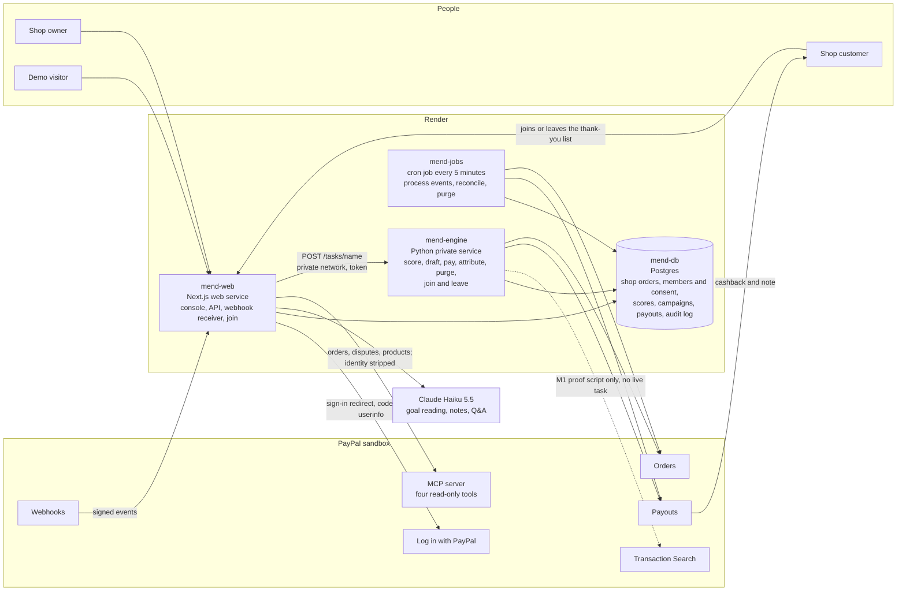
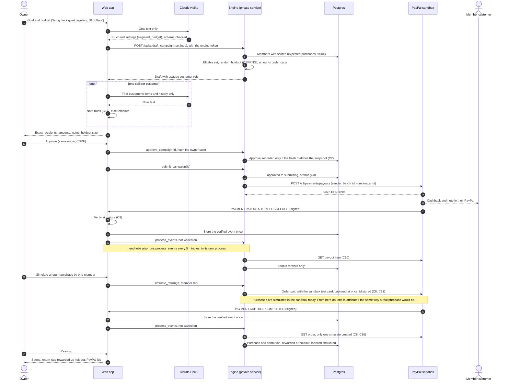
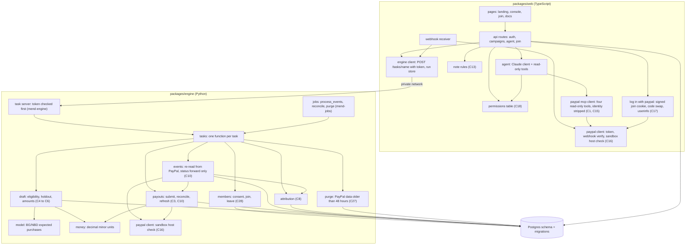

# Mend architecture

Mend finds a small shop's regular customers who have gone quiet, using the shop's own order records, and sends each a thank-you cashback into their PayPal, after the owner approves. Only customers who joined the shop's thank-you list with Log in with PayPal can be paid. A random holdout group in every campaign gets nothing, so the lift is measured.

Everything runs against the PayPal sandbox. Security rules referenced as C1 to C28 are in `docs/security/threat-model.md`.

## Parts

| Part | Where it runs | Job |
|---|---|---|
| Web app (`packages/web`) | Next.js on a Render web service (mend-web, Starter) | Landing page, owner and demo console, join page, `/docs`; API routes for sign-in, campaigns and the agent; the PayPal webhook receiver. Calls the engine over Render's private network. After storing each verified webhook it asks the engine to run process_events at once, without waiting for the answer. Reads PayPal orders, disputes and products through PayPal's hosted MCP server from its own server: four read-only tools, with identity fields stripped before Claude sees anything. Runs Join with PayPal (Log in with PayPal, sandbox): the confirmation page, the sign-in redirect and the callback. Talks to Claude. Never sends money itself. |
| Engine (`packages/engine`) | Python task server, a Render private service (mend-engine, Starter), reachable only on Render's private network at `http://mend-engine:10000` behind a shared token (`MEND_ENGINE_TOKEN`) | Imports the shop's own order records; scores customers with BG/NBD; builds campaign drafts (eligible set, holdout, amounts, all in code); sends approved batches through Payouts; reconciles and refreshes payout status; records purchases and attribution. The only code that moves money (C1). |
| Database | Render Postgres (mend-db, basic 256 MB, Postgres 18, virginia) | Shop order records, members and consent, customer scores, campaigns and snapshots, payout items, attribution, sessions, append-only audit log (C23). |
| Scheduled jobs (`mend_engine.jobs`) | Render cron job every 5 minutes (mend-jobs, Starter) | Runs process_events, reconcile and purge directly in Python against the database. It never calls mend-engine and holds no engine token. process_events re-reads each stored webhook's resource from PayPal and acts only on PayPal's answer (C10); reconcile settles campaigns whose batch outcome is unknown without ever making a second batch (C3); purge deletes PayPal data older than 48 hours (C27). |
| Operator scripts (`scripts/`) | A developer's machine | Import the real dataset as the demo shop's order records; reproduce the published benchmark; run the backtest; the prove-it command. |
| PayPal (sandbox) | PayPal | OAuth, Transaction Search, Orders, Payouts, webhooks, Log in with PayPal. |
| Claude Haiku 5.5 | Anthropic API | Reads the owner's goal into structured campaign settings; writes one note per customer; answers the owner's questions through read-only tools. Never chooses an amount or a recipient (C4, C5, C11). |

Where each PayPal call lives:

| PayPal call | Caller | How |
|---|---|---|
| `POST /v1/oauth2/token` | web, engine | REST, token cached until `expires_in` |
| Transaction Search `GET /v1/reporting/transactions` | M1 proof script only (`mend_engine.prove_m1`) | Server SDK `TransactionSearchController` (Python). Used only by the M1 proof script today; no live task calls it. |
| Payouts create, show batch, show item, cancel unclaimed | engine | REST (no SDK covers Payouts) |
| Webhooks create, list, verify signature | web | REST |
| Orders create and capture (simulate purchase, seeding) | engine, scripts | Server SDK `OrdersController` |
| Log in with PayPal (`/connect`, `/v1/oauth2/token`, userinfo `schema=paypalv1.1`) | web | REST; scopes openid, email, paypalattributes |
| PayPal's hosted MCP server, four read-only tools (`get_order`, `list_disputes`, `get_dispute`, `show_product_details`) | web agent, through mend-web's own server | Mend's MCP client (`paypal-mcp.ts`) at `mcp.sandbox.paypal.com`; any other tool name is refused before a token is fetched, and each answer is rebuilt from listed fields with identity stripped before Claude sees it |

## 1. System overview

## 2. Main sequence: one campaign, end to end

## 3. Module dependencies

## Interface the frontend will use

Filled in at the backend handoff (6l): every API route, its request and response shape, and the exact reads and writes each screen makes. Not written yet.

## Open items

- Settled: how the web calls the engine. Each task is one `POST /tasks/<name>` with the body `{"args": [...]}` and the `x-mend-engine-token` header, sent to `MEND_ENGINE_URL` (`http://mend-engine:10000`). The web refuses to send anything unless that address is plain `http` to a one-label host (a Render private network name: no dots, not an IP address, not localhost) with no path, query or userinfo, and the token is at least 32 printable characters. Redirects are refused, so the token cannot be carried to another host. The call runs in the background with a 120-second limit; the route answers with a run id, the run's state lives in an in-process run store (the latest 500 runs, none kept across a restart), and `GET /api/runs/<id>` polls it, answering only the session that started the run. An answer over 1 MB or of the wrong shape counts as a failed run (C12). The engine compares the token in constant time before it reads the path or body, runs at most 16 tasks at once, and answers 503 after 60 seconds without a free slot. mend-jobs does not use this path: it runs its three tasks in its own process. This private service replaced Render Workflows on 24 Oct, because a Render API key is account-wide and would have had to sit on the web service.
- Closed 26 Oct: Log in with PayPal returns `payer_id` under `schema=paypalv1.1`, in an answer that gives the email as an `emails` list of `{value, primary, confirmed}` (seen live on 26 Oct). The payer id is stored with the member, not matched on: members are found by their email, and the payer id is only compared to refuse a sign-in that conflicts with it.
- Transaction Search lag on this app (M0 rows not visible after 27 minutes on 20 Oct): recheck.
