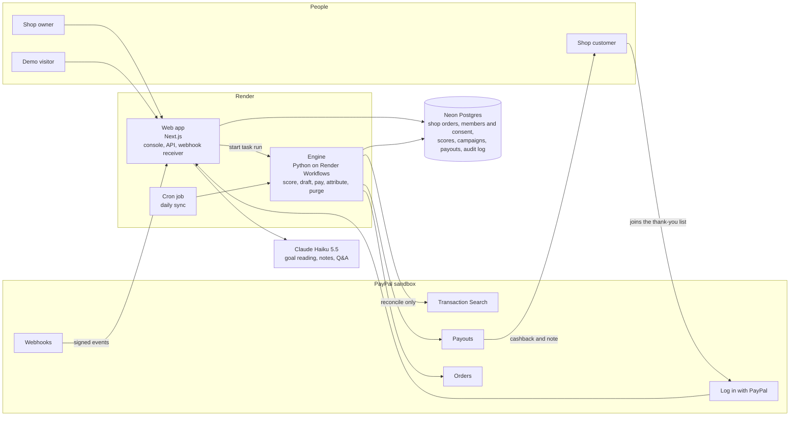
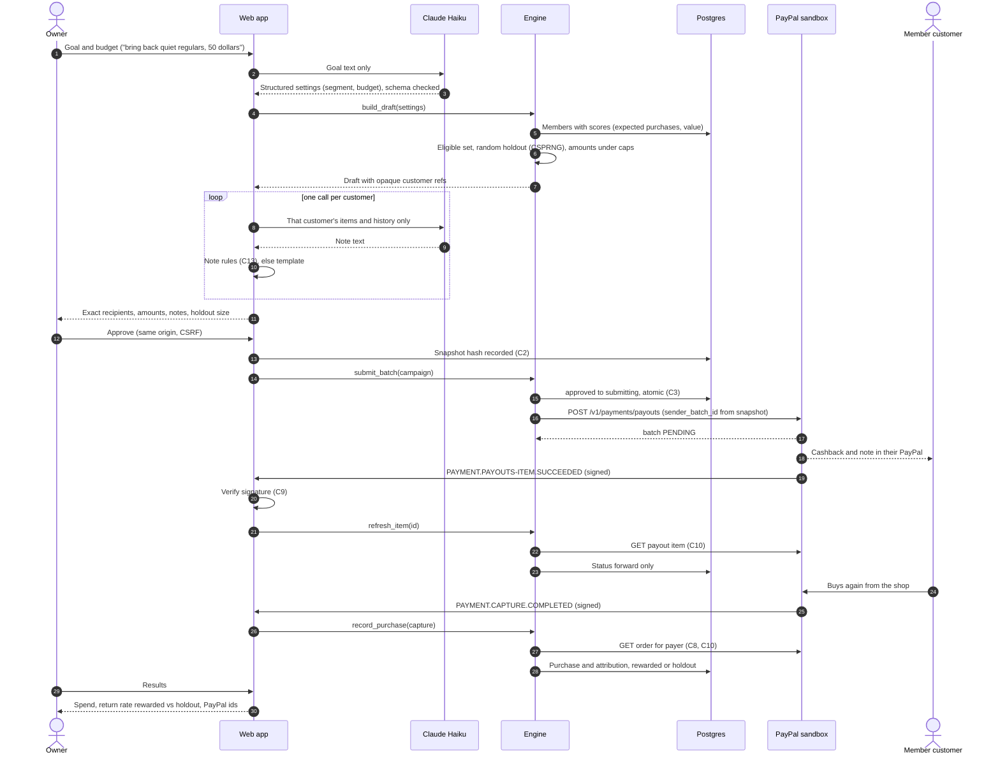
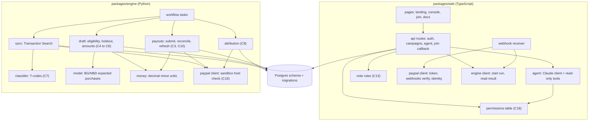

# Mend architecture

Mend finds a small shop's regular customers who have gone quiet, using the shop's own order records, and sends each a thank-you cashback into their PayPal, after the owner approves. Only customers who joined the shop's thank-you list with Log in with PayPal can be paid. A random holdout group in every campaign gets nothing, so the lift is measured.

Everything runs against the PayPal sandbox. Security rules referenced as C1 to C26 are in `docs/security/threat-model.md`.

## Parts

| Part | Where it runs | Job |
|---|---|---|
| Web app (`packages/web`) | Next.js on a Render web service | Landing page, owner and demo console, join page, `/docs`; API routes for sign-in, campaigns and the agent; the PayPal webhook receiver; the Log in with PayPal callback. Talks to Claude. Never sends money itself. |
| Engine (`packages/engine`) | Python tasks on Render Workflows | Imports the shop's own order records; scores customers with BG/NBD; builds campaign drafts (eligible set, holdout, amounts, all in code); sends approved batches through Payouts; reconciles and refreshes payout status; records purchases and attribution. The only code that moves money (C1). |
| Database | Neon Postgres | Shop order records, members and consent, customer scores, campaigns and snapshots, payout items, attribution, sessions, append-only audit log (C23). |
| Scheduler | Render cron job | Starts the daily scoring run, the attribution-window close and the 48-hour PayPal-data purge (C27). |
| Operator scripts (`scripts/`) | A developer's machine | Import the real dataset as the demo shop's order records; reproduce the published benchmark; run the backtest; the prove-it command. |
| PayPal (sandbox) | PayPal | OAuth, Transaction Search, Orders, Payouts, webhooks, Log in with PayPal. |
| Claude Haiku 5.5 | Anthropic API | Reads the owner's goal into structured campaign settings; writes one note per customer; answers the owner's questions through read-only tools. Never chooses an amount or a recipient (C4, C5, C11). |

Where each PayPal call lives:

| PayPal call | Caller | How |
|---|---|---|
| `POST /v1/oauth2/token` | web, engine | REST, token cached until `expires_in` |
| Transaction Search `GET /v1/reporting/transactions` (reconciliation only, purged within 48 hours) | engine | Server SDK `TransactionSearchController` (Python) |
| Payouts create, show batch, show item, cancel unclaimed | engine | REST (no SDK covers Payouts) |
| Webhooks create, list, verify signature | web | REST |
| Orders create and capture (simulate purchase, seeding) | engine, scripts | Server SDK `OrdersController` |
| Log in with PayPal (`/connect`, `/v1/oauth2/token`, userinfo `schema=paypalv1.1`) | web | REST; scopes openid, email, paypalattributes |
| Agent Toolkit read-only tools (`list_transactions`, `get_order`, products) | web agent | `@paypal/agent-toolkit` with an explicit read-only `actions` map and `sandbox: true` |

## 1. System overview

## 2. Main sequence: one campaign, end to end

## 3. Module dependencies

## Interface the frontend will use

Filled in at the backend handoff (6l): every API route, its request and response shape, and the exact reads and writes each screen makes. Not written yet.

## Open items

- Web starts engine tasks with `render.workflows.startTask('<workflow>/<task>', [args], { idempotencyKey })` from `@renderinc/sdk` 1.3.0 and polls `getTaskRun(id)`; cron starts runs the same way. Auth is a Render API key.
- Log in with PayPal userinfo fields (`payer_id`) to be confirmed from one saved sandbox response before matching code is written.
- Transaction Search lag on this app (M0 rows not visible after 27 minutes on 20 Oct): recheck.
