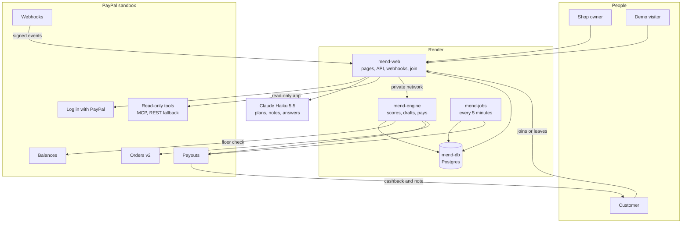
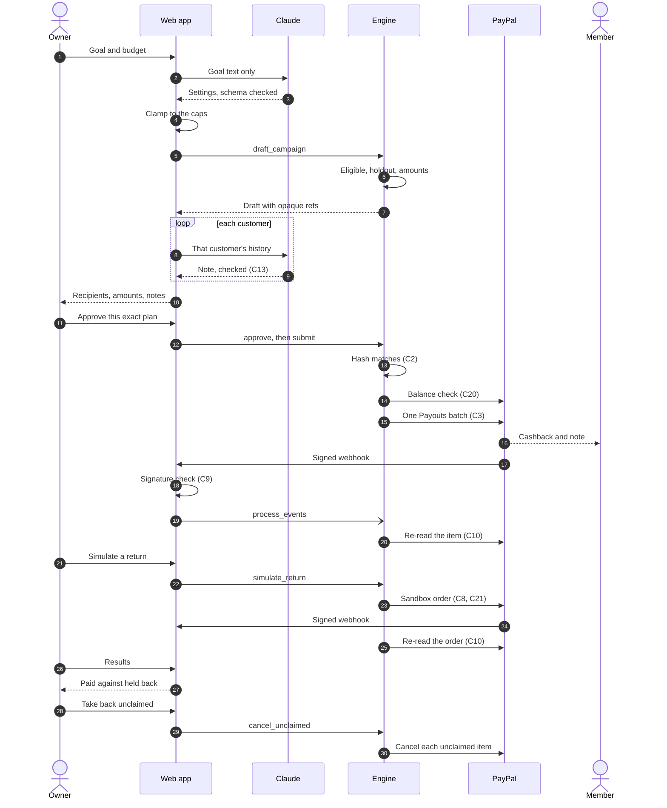
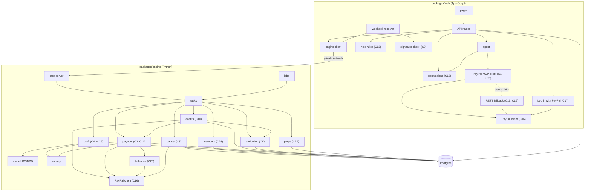

# Mend

Mend repairs the relationship with customers who drifted away.

Mend finds a shop's regulars who have gone quiet, has Claude draft a small cashback plan, pays it through PayPal Payouts to customers who joined with Log in with PayPal, and holds a random group back to measure whether it worked. It runs on the PayPal sandbox today, with two years of a real UK gift shop's orders replayed as the demo shop.

[Live app](https://mend-web.onrender.com) · [Try the demo](https://mend-web.onrender.com/demo) · [Docs](https://mend-web.onrender.com/docs)

## Live deployments

| Part | Where | What it does |
|---|---|---|
| Web app, `mend-web` | https://mend-web.onrender.com, a Render web service | The landing page, the demo console at `/demo`, the docs at `/docs`, the API, the PayPal webhook receiver and Join with PayPal |
| Engine, `mend-engine` | A Render private service with no public URL | Scores customers, builds drafts, sends Payouts batches, cancels unclaimed rewards, records returns. The only code that moves money |
| Jobs, `mend-jobs` | A Render cron job, every 5 minutes | Runs purge, process_events, reconcile, refresh_items and cancel_demo_unclaimed |
| Database, `mend-db` | Render Postgres 18 | Order records, members and their consent, campaigns, payouts and an append-only audit log |
| PayPal webhook | Sandbox webhook `8N112937B9769545W`, posting to `/api/webhooks/paypal` | 12 event types: 8 for payout items, 3 for payout batches, 1 for completed captures |
| Claude | `claude-haiku-5-5` on the Anthropic API | Reads the owner's goal, writes the notes, answers the owner's questions |

Everything is PayPal sandbox. No real money moves.

## Why PayPal is the heart of it

- The reward lands in the PayPal wallet the customer already pays with, one tap from their next order at the same shop.
- Customers opt in with Log in with PayPal. Mend keeps their payer id, their email and whether PayPal verified it, and pays nobody who has not joined.
- Each approved campaign goes out as one PayPal Payouts batch, every item carrying the shop's own note.
- PayPal's webhooks report each payment. Mend checks every signature itself against PayPal's certificate, then re-reads the payout from PayPal before it records anything.
- Cashback nobody claims comes back to the shop through the Payouts cancel call.
- The assistant reads orders and disputes through PayPal's MCP server, with keys from a second PayPal app that cannot send payouts.

## Overview

Regular customers rarely leave with a complaint. They stop ordering, and a small shop notices months later, if at all. The usual fixes are a discount code sent to everyone or a points scheme, and neither tells the owner whether the money changed anything.

Mend works from the shop's own order history. A forecast ranks the regulars who have gone quiet. The owner writes a goal in one sentence, Claude turns it into a capped plan and writes a short note for each customer, and the owner approves that exact plan. PayPal pays it as cashback. A random part of the list is held back and gets nothing, so Mend can compare the two groups and say whether the cashback brought people back, or say plainly that it is too early to tell.

| | Blanket discount email | Loyalty points app | Mend |
|---|---|---|---|
| Who gets the money | Everyone who uses the code, including people who would have paid full price | Customers who are already buying | Quiet regulars who joined the shop's list with PayPal, a few dollars each, in their PayPal |
| How they are chosen | Nobody is chosen | By how much they spend | Ranked by a forecast from the shop's own orders; code builds the list and the owner approves it |
| How you know it worked | Sales after the email, with nothing to compare against | Hard to separate loyalty from habit | A random held-back group, compared with Fisher's exact test |
| What it costs when nobody returns | Little, but every full-price buyer who uses the code costs margin | The app's fee keeps running | The cashback sent, under hard caps, and unclaimed cashback can be taken back |

## Features

### Find who is drifting

- A BG/NBD forecast, fitted on the shop's own order records, gives each customer's expected purchases over the next 13 weeks.
- Quiet regulars are customers with 3 or more purchase days who have been silent for 60 days or more. The demo shop has 1,357 of them (29 Oct 2026).
- The model reproduces the published CDNOW parameters: r 0.243, alpha 4.414, a 0.793, b 2.426, log-likelihood -9582.4.
- The backtest says what it found. Among quiet regulars the forecast ties ranking by most recent order: it won 3 of 5 test dates, mean AUC difference -0.005, 95 percent range -0.024 to +0.016. Across all customers it wins 5 of 5, +0.052, range +0.048 to +0.057. On 9 Sep 2011 the safest tenth of 5,256 customers came back within 91 days 92 percent of the time, and the most at risk tenth 10 percent.

### Plan it with Claude

- Write a goal in a sentence. Claude reads it into a budget, a reward size, a held-back share and how many customers to consider. Code clamps every value to the caps and lists what it changed.
- Claude writes one short note per customer from that customer's own past items. A note must pass a character rule (no links, emails, phone numbers or markup), or the shop's template is used instead.
- Ask Mend: an assistant that answers from live data through Mend's tools and PayPal's four read-only tools. It can put a draft in the approval queue. It cannot approve, pay or refund.

### Pay through PayPal

- Approve the exact plan. Mend records a fingerprint (a hash) of every recipient, amount and note, and builds the batch from that frozen copy. Any change voids the approval.
- One Payouts batch per campaign, sent at most once, even under retries and double clicks.
- The shop's PayPal balance is read before every send, and nothing goes out if the batch and its fees would take it under the floor (USD 250 by default).
- Each customer's thread on screen is stitched as PayPal confirms their payment.
- Take back unclaimed cashback with one click. When PayPal fails one item, Mend reports what came back and what is still waiting.

### Measure honestly

- The held-back group is drawn by code from a secure random source before Claude sees anyone, and it is never paid.
- Returns count for 30 days from the send. Mend uses Fisher's exact test and gives a verdict and a p-value only after the window closes, with at least 30 members in each group and 5 returns expected in the smaller one. Until then it says "too early to tell".
- Simulated returns are labelled and kept out of the verdict.

### Guardrails

- Demo caps in code: USD 2.00 per customer, USD 10.00 per campaign, USD 50.00 a day across all demo visitors.
- Sandbox only. Mend refuses to start with any other PayPal setting.
- Customer emails never reach Claude, and the assistant's PayPal keys cannot send payouts.

## PayPal pieces used

| PayPal piece | What Mend uses it for | Where in the code |
|---|---|---|
| Payouts API | Create one batch per approved campaign (`POST /v1/payments/payouts`), read the batch and each item, cancel an unclaimed item (`POST /v1/payments/payouts-item/{id}/cancel`) | `packages/engine/mend_engine/paypal/payouts.py`, `campaigns/cancel.py` |
| Log in with PayPal | Customers join or leave the shop's thank-you list. Scopes openid, email and paypalattributes; Mend keeps the payer id, the email and whether PayPal verified it | `packages/web/src/server/paypal-login.ts`, `src/app/api/join/` |
| Webhooks | 12 event types (payout items, payout batches, completed captures). The signature is checked in the app against PayPal's certificate, then the resource is re-read from PayPal | `packages/web/src/server/webhook-signature.ts`, `webhooks.ts`, `packages/engine/mend_engine/events/process.py` |
| Orders v2 | The simulated return purchase: one order paid with PayPal's sandbox test card and captured at once | `packages/engine/mend_engine/campaigns/simulate.py` |
| Reporting balances | `GET /v1/reporting/balances` before every send and resend; nothing is sent under the USD 250 floor | `packages/engine/mend_engine/paypal/balances.py` |
| PayPal's hosted MCP server | The assistant's four read-only tools: get_order, list_disputes, get_dispute, show_product_details. Any other tool name is refused before a token is fetched. When the server fails, the same four reads go straight to PayPal's REST API under the same rules | `packages/web/src/server/paypal-mcp.ts`, `paypal-read.ts` |
| A read-only PayPal app | A second sandbox app created without the Payouts permission, used only for those four reads. PayPal answers 403 when its token asks for a payout batch | `packages/web/src/server/config.ts` |

## How it works

### System overview



### One campaign, end to end



### Module dependencies



The parts, every PayPal call and who makes it are in [ARCHITECTURE.md](ARCHITECTURE.md). The C numbers are the rules in the [threat model](docs/security/threat-model.md).

## The two-minute judge path

Everything here runs on the PayPal sandbox: real Payouts batches and real PayPal webhooks, with test money. No sign-up and no PayPal login.

1. Open https://mend-web.onrender.com/demo and press **Start the demo**. A demo session opens for this browser.
2. Step 1 shows the quiet regulars, ranked by Mend's forecast with the most at risk first, and how many there are. Rows marked as stand-ins are demo customers the seed script joined, not people. Press **Ask Claude for a plan**.
3. Step 2: pick a suggestion such as "Win back my best lapsed regulars with 10 dollars", or type your own goal with an amount. Claude's plan shows the budget, the reward per customer, the share held back, how many customers were considered, and anything Claude adjusted to fit the demo caps. Press **Review the plan**.
4. Step 3 shows every reward with its note and every held-back customer as a dotted thread. Optionally press **Have Claude write the notes** for one personal note per customer from their own past items. Press **Approve this exact plan**: Mend seals the plan and shows its fingerprint. Press **Send it with PayPal**.
5. Step 4: press **Send with PayPal**. Mend sends one Payouts batch and shows PayPal's batch id. Watch the threads: each one is stitched as PayPal confirms that customer's payment, usually within about a minute. The most at risk customer is the one real sandbox account, so when the random draw pays it, PayPal marks its reward claimed. The stand-ins have no PayPal account, so PayPal holds their cashback as unclaimed. Press **See the results**.
6. Step 5 compares the paid group with the held-back group and gives the verdict, which for a five-person demo group is "too early to tell". Press **Simulate a return purchase**: Mend buys from the shop with PayPal's sandbox test card for the customer you pick, and the return is counted for their group as simulated.
7. Press **Take back** (the button shows the amount) to cancel the unclaimed cashback. PayPal returns it to the shop, and the results show how much came back. If you leave it, mend-jobs takes it back on its own once it has waited 10 minutes.
8. Ask Mend in the side panel, for example "How many quiet regulars does my shop have right now?". It answers from live data and says which tools it used.

### The proof we run

`node scripts/deploy/render.mjs prove` checks the live deployment end to end. It needs our Render API key, so judges read its output instead of running it. The last run, on 29 Oct 2026 against commit `bdb4139`, passed 19 of 19:

```text
PASS  health: https://mend-web.onrender.com/api/health says ok
PASS  plan: mend-web, mend-engine and mend-jobs are Starter, mend-db is basic 256 MB, region virginia, no other paid service
PASS  env: each service holds exactly the settings it needs, PAYPAL_ENV is sandbox everywhere, each service uses its own database role
PASS  render key: no service holds RENDER_API_KEY, under that name or any other
PASS  database role: mend_engine is refused a trigger change, an audit_log update and CREATE TABLE (SQLSTATE 42501); mend_web is refused an update of payout_items, an audit_log update and CREATE TABLE
PASS  private: mend-engine has no public URL and does not resolve on public DNS
PASS  journey plan: a demo visitor asked "bring back my quiet regulars, 50 dollars"; Claude read it; 5 rewarded at 200 cents (1000 in total), 5 held back
PASS  journey notes: Claude wrote 5 personal notes, 0 fell back to the shop's template
PASS  journey payout: viewed with its hash, approved with that hash and submitted; PayPal holds batch EY5YRBZFV4DX4
PASS  read keys: the read-only app's token carries 27 scopes, none for payouts, and PayPal answers 403 to a payout batch read
PASS  delivery: PayPal's batch webhook was verified and stored once, processed 1 s after it arrived; the test receiver's item was SUCCESS 54 s after submit
PASS  cancel: the 4 unclaimed rewards were cancelled, returnedMinor 800, stillUnclaimed 0, incomplete false
PASS  demo pool: the campaign counted 1000 cents toward the demo pool before the cancel and 200 after
PASS  forgery: an altered copy of that delivery was refused by the signature check (400); a replay was answered 200 with nothing stored
PASS  simulate: a return purchase (PayPal order 0CA16656SK6898736, COMPLETED) was attributed to the rewarded group as simulated; verdict: too early to tell
PASS  agent: asked "How many quiet regulars does my shop have right now?", it used shop_summary and answered 1357
PASS  jobs: mend-jobs last ran successfully at 2026-10-29T03:45:37Z and the purge is on record in audit_log
PASS  idempotent: `up` would change nothing
PASS  secrets: no secret value or key shape in the output, render-state.json, 225 answers from mend-web or 612 log lines
D2 RESULT: PASS
```

Each line is condensed from the script's own output. What `prove` checks is described in [scripts/deploy/README.md](scripts/deploy/README.md).

## Run it yourself

Mend runs on one machine with `npm run dev:console`: a local Postgres, the engine, the scheduled jobs every 30 seconds and the web app, with the demo shop built from the real dataset. It was built and tested on Windows 11. The macOS and Linux commands below follow the same scripts but have not been run there.

### What you need

- Node.js 26 (Render runs 26.7.0) and Python 3.12.
- A PayPal developer account (https://developer.paypal.com). In the sandbox:
  - A US business account and an app linked to it, with Payouts and Log in with PayPal ticked. This app sends the cashback.
  - Optional: a second app on the same business account with Payouts not ticked. The assistant's PayPal reads use it. Without it they use the first app.
  - A personal account. Its email is the test receiver: the one demo customer whose cashback can really be claimed.
- An Anthropic API key with prepaid credit (https://platform.claude.com, Settings, API Keys; credit under Billing). The local console will not start without it.
- On Windows, Git Bash (it comes with Git for Windows): the commands below are Bash.

### Steps

```bash
git clone https://github.com/ramakrishnanhulk20/Mend.git
cd Mend
cp .env.example .env
```

Fill in `.env` at the repo root now, using the table below. Then:

```bash
cd packages/engine
python -m venv .venv
source .venv/Scripts/activate    # macOS and Linux: source .venv/bin/activate
pip install -e ".[test]"

cd ../web
npm ci
npm run dev:console
```

The settings in `.env`:

| Setting | What it is | Where to get it |
|---|---|---|
| `PAYPAL_CLIENT_ID`, `PAYPAL_CLIENT_SECRET` | The sandbox app that sends payouts | developer.paypal.com, Apps & Credentials, Sandbox, your app |
| `PAYPAL_ENV` | Must be `sandbox`; Mend refuses anything else | Already set in `.env.example` |
| `PAYPAL_READ_CLIENT_ID`, `PAYPAL_READ_CLIENT_SECRET` | Optional: the second app, without Payouts | The same page, your second app |
| `MEND_TEST_RECEIVER` | The sandbox personal account's email | developer.paypal.com, Sandbox, Accounts |
| `ANTHROPIC_API_KEY` | Claude, for plans, notes and the assistant. Required: the console will not start without it | platform.claude.com, Settings, API Keys |
| `MEND_PAYOUT_ITEM_CAP_MINOR`, `MEND_CAMPAIGN_CAP_MINOR`, `MEND_DAILY_CAP_MINOR` | The owner's hard caps in US cents (USD 10 a customer, 100 a campaign, 200 a day); the engine will not start without them. Demo visitors get tighter limits on top: USD 2 a customer, 10 a campaign, 50 a day across all visitors | Keep the values in `.env.example` |
| `MEND_BALANCE_FLOOR_MINOR` | US cents every payout must leave in the shop's balance | Leave empty for 25000 (USD 250) |
| `MEND_DEV` | Local development | Keep `1` |
| `DATABASE_URL` | Leave empty: the local run uses its own Postgres | |
| `MEND_OWNER_PASSWORD` | Optional locally: the owner sign-in | Any long random value |
| `PAYPAL_WEBHOOK_ID`, `RENDER_API_KEY` | Only for deploying to Render | Not needed locally |

The first run builds the local demo shop: it downloads UCI Online Retail II, imports it and measures the model, which takes about two minutes. Later runs start in seconds. When it prints `console ready: http://localhost:3001/demo`, open that address and follow the judge path above.

Payouts here are real sandbox payouts from your sandbox business account, with PayPal's test money. No webhook can reach your machine, so payment statuses arrive through the jobs, which run every 30 seconds and read a new batch back after 45 seconds. Log in with PayPal needs a return address PayPal can reach, so the local run skips it: the seed script makes your test receiver a member. `npm run dev:console -- --port 3005` picks another port. More detail and troubleshooting are in the [Run locally](https://mend-web.onrender.com/docs/getting-started/run-locally) docs page.

## API

Every route a visitor's browser calls. Each state-changing POST needs an `Origin` equal to the site's own and the `x-mend-csrf` header from `GET /api/session`. A route that waits on the engine may answer `202 {status: "running", runId}`; the browser then polls `GET /api/runs/<runId>`. Limits and shapes are on the [API docs page](https://mend-web.onrender.com/docs/developers/api).

| Method | Path | What it does |
|---|---|---|
| GET | `/api/session` | Says whether this browser is signed in and gives a CSRF token |
| POST | `/api/session/demo` | Opens a demo session |
| POST | `/api/session/logout` | Ends the session |
| GET | `/api/shop/summary` | The shop's live counts, the benchmark and the backtest |
| GET | `/api/shop/quiet-regulars` | Quiet regulars ranked by the forecast, most at risk first |
| POST | `/api/campaigns/plan` | Claude reads a goal and the engine drafts a campaign within the caps |
| POST | `/api/campaigns` | Drafts a campaign from settings given directly |
| GET | `/api/campaigns/<id>` | Every reward, note and held-back row, with the review fingerprint |
| POST | `/api/campaigns/<id>/notes` | Claude writes one note per rewarded customer |
| POST | `/api/campaigns/<id>/approve` | Approves the plan whose fingerprint the visitor saw |
| POST | `/api/campaigns/<id>/submit` | Sends the approved plan as one PayPal Payouts batch |
| POST | `/api/campaigns/<id>/simulate` | Buys once from the shop with PayPal's sandbox test card for one customer |
| GET | `/api/campaigns/<id>/results` | Paid against held back, the verdict, and where each payout stands |
| POST | `/api/campaigns/<id>/cancel-unclaimed` | Asks PayPal to return every unclaimed reward to the shop |
| POST | `/api/agent` | One message to Ask Mend, answered through Mend's tools |
| GET | `/api/runs/<runId>` | The answer of a route that was still waiting |
| GET | `/api/join/consent` | The exact words a customer agrees to by joining |
| GET, POST | `/api/join/paypal/start` | The join or leave confirmation page, and the click that starts Log in with PayPal |
| GET | `/api/join/paypal/callback` | Where PayPal sends the customer back; records the join or the leave |

## Tests

Run on 29 Oct 2026:

```text
packages/engine$ .venv/Scripts/python.exe -m pytest -q -p no:cacheprovider
937 passed, 1 skipped

packages/web$ npx vitest run
 Test Files  32 passed (32)
      Tests  1166 passed (1166)
```

The engine tests need no network; they start a local Postgres. In a fresh clone 3 benchmark tests skip (934 passed, 4 skipped) until `python -m mend_engine.prove_model` has downloaded the CDNOW sample once. The live proof, `node scripts/deploy/render.mjs prove`, passed 19 of 19 on the same day (above).

## What it costs

- PayPal: the sandbox charges USD 0.25 per payout item, in test money. A demo campaign of 5 rewards sends USD 10.00 and pays USD 1.25 in sandbox fees.
- Claude Haiku 5.5: one call reads the goal and one call writes each note, so a demo campaign with personal notes uses 6 calls. The demo is capped at 40 calls a day per session, 80 a day per address and 50 an hour across all visitors, with token budgets on top.
- Hosting: about USD 22 a month on Render: mend-web and mend-engine at about USD 7 each, mend-db at about USD 6, and mend-jobs at USD 1 a month plus run minutes.

## Project structure

```text
packages/
  web/                 Next.js app: landing, demo console, /docs, API routes, webhook receiver
    src/app/           pages and API routes
    src/server/        PayPal, MCP client, webhook check, sessions, limits, Claude
    src/components/    the landing page and the console
    content/docs/      the /docs pages
    evals/             injected-text and owner-request sets for the AI
    scripts/           dev:console and the local proofs
  engine/              Python: scoring, drafts, payouts, cancels, attribution, jobs
    mend_engine/
    tests/
scripts/deploy/        render.mjs: build, check and prove the Render setup
docs/security/         threat-model.md
ARCHITECTURE.md
LICENSE
```

## Tech stack

| Layer | What |
|---|---|
| Web | Next.js 16.4.2, React 19.3.1, TypeScript 6.0.3, Tailwind CSS 4.3.3, motion 14.7.1, Lenis 1.3.27, zod 4.6.7, node-postgres 8.23.1 |
| Docs | Fumadocs (fumadocs-ui 16.17.9, fumadocs-core 16.17.9, fumadocs-mdx 15.4.10) serves the `/docs` route from `packages/web/content/docs` |
| Diagrams | Mermaid 12.2.0, drawn in the browser |
| AI | Claude Haiku 5.5 (`claude-haiku-5-5`) through `@anthropic-ai/sdk` 1.3.0 |
| Engine | Python 3.12, httpx 0.28.1, psycopg 3.3.6, NumPy 2.5.4, SciPy 1.18.1, openpyxl 3.1.5 |
| PayPal | Sandbox REST APIs, PayPal's hosted MCP server, `paypal-server-sdk` 2.4.0 for one proof script |
| Database | Postgres 18 on Render; pgserver 0.1.4 locally |
| Hosting | Render: a web service, a private service, a cron job and Postgres, region virginia |
| Tests | Vitest 5.0.5, pytest 9.1.1, Hypothesis 6.170.5 |

## Security

- The owner approves a fingerprint of the exact recipients, amounts and notes. The batch is built from that frozen copy, and any change voids it.
- Amounts are set by code in whole cents and checked against the caps when the draft is built and again at approval. Claude never sets an amount or a recipient.
- Sandbox only: every PayPal address is parsed and must equal a sandbox host exactly.
- The engine and the web app connect to the database as separate roles. Neither can change the schema or a trigger, and the audit log only accepts new rows.
- Webhooks are verified in the app against PayPal's certificate, and each one is only a prompt to re-read the payout from PayPal.
- The assistant's PayPal keys cannot send payouts, and only four read tools can be called.
- No customer email reaches Claude: prompts carry opaque references, item names and counts.

Three review rounds on 26 and 27 Oct 2026 found 16 important issues, and a separate audit on 27 Oct found 15 more, closed on 28 Oct. Every one was fixed with a test that failed before the fix. These are self-audits, not an outside firm's; the [reviews page](https://mend-web.onrender.com/docs/security/reviews) says how they were run. The full threat model is [docs/security/threat-model.md](docs/security/threat-model.md).

## Licence

MIT. See [LICENSE](LICENSE).

## Acknowledgments

- The PayPal developer platform: Payouts, Log in with PayPal, Webhooks, Orders and the hosted MCP server.
- Anthropic's Claude.
- The UCI Machine Learning Repository and Daqing Chen for Online Retail II (Chen, D. (2012), https://doi.org/10.24432/C5CG6D, CC BY 4.0).
- Fader, Hardie and Lee (2005) for the BG/NBD model and the CDNOW sample.
