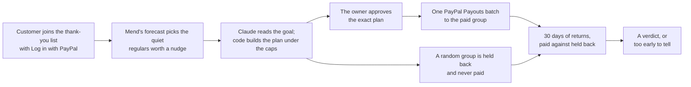

## The journey

1. A customer joins the shop's thank-you list with Log in with PayPal. Mend records the consent and the PayPal identity to pay. Nobody else can be paid. See [Join and leave](/docs/guides/join-and-leave).
2. Mend's forecast reads the shop's own order records and looks at the regulars who have gone quiet: customers who bought on 3 or more days and have been silent for 60 days or more. It skips those likely gone and those likely to come back anyway, and lists the rest biggest spenders first. See [The forecast](/docs/concepts/the-forecast).
3. The owner writes a goal in a sentence. Claude reads it into a budget, a reward size, a held-back share and how many customers to consider. Code clamps every number to the caps, picks the customers from that list and draws the held-back group at random before Claude sees anyone. Claude then writes a short note for each paid customer. See [Plan with Claude](/docs/guides/plan-with-claude).
4. The owner reads every reward and note and approves the plan by its fingerprint. Mend sends exactly that plan as one PayPal Payouts batch, after checking the shop's balance. See [Approve and pay](/docs/guides/approve-and-pay).
5. PayPal's webhooks and Mend's scheduled reads report each payment. Cashback nobody claims can be taken back. See [Take back unclaimed cashback](/docs/guides/take-back-unclaimed).
6. For 30 days, purchases by both groups are counted. Mend compares them with Fisher's exact test once there is enough data, and says "too early to tell" until then. See [Measuring lift](/docs/concepts/measuring-lift).

## The thread picture

Mend draws customers as threads, and the console draws one thread for each customer in a campaign.

- A thread cut in the middle, with frayed ends, is a regular who went quiet.
- Dots bridging the cut are a customer held back on purpose. They are never paid, which is what makes the comparison fair.
- A faint dashed line across the cut is a reward approved and waiting to be sent, or one whose status Mend will check again.
- A dot crossing the cut is a payment PayPal is processing.
- A red cross-stitch over the cut is cashback PayPal has sent or the customer has claimed: the relationship mended.
- A dotted line across the cut on a paid row is cashback that came back to the shop.
- A knot at the end of a thread is a customer who came back and bought again. A simulated return is labelled "came back (simulated)".

On the landing page, ten broken threads show the demo's default campaign: five stitched in red for the customers paid, five bridged with dots for the customers held back.

## What runs where

- The web app on Render serves the site, the demo console and these docs, talks to Claude, receives PayPal's webhooks and runs Join with PayPal. It never sends money.
- The engine, a private service on Render with no public address, scores customers, builds drafts, sends Payouts batches, cancels unclaimed rewards and records returns. It is the only code that moves money.
- A scheduled job every 5 minutes deletes stored PayPal data at 47 hours, processes webhooks, settles any send whose outcome is unclear, re-reads payments still unsettled after 15 minutes and takes back demo cashback left unclaimed for 10 minutes.
- Postgres on Render holds the order records, members and consent, campaigns, payouts and an audit log that only accepts new rows.

The full picture, with every PayPal call, is on the [architecture page](/docs/developers/architecture).
