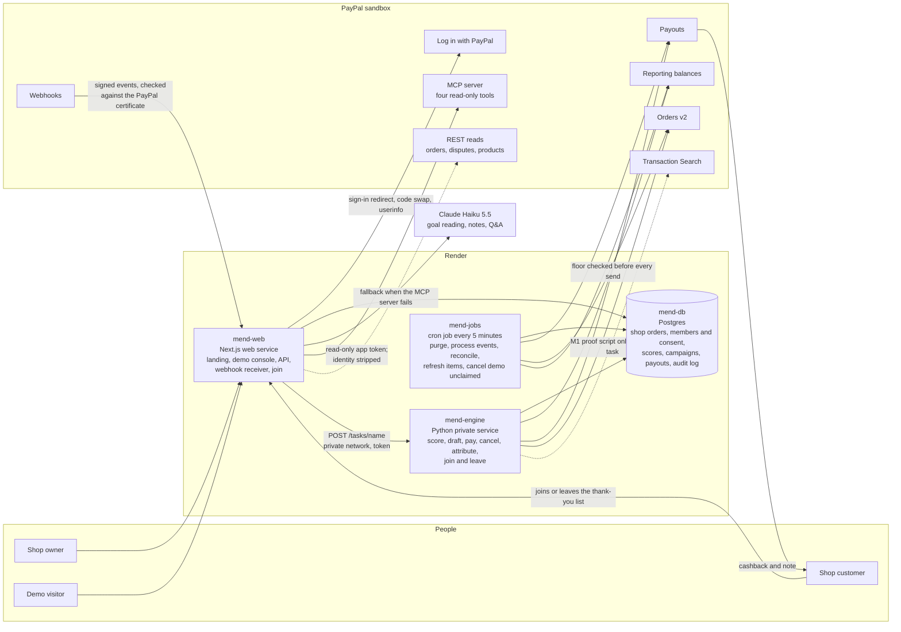
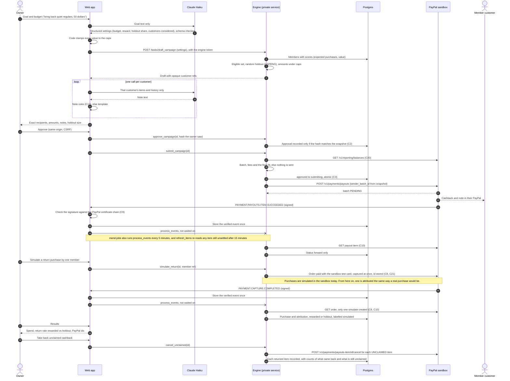
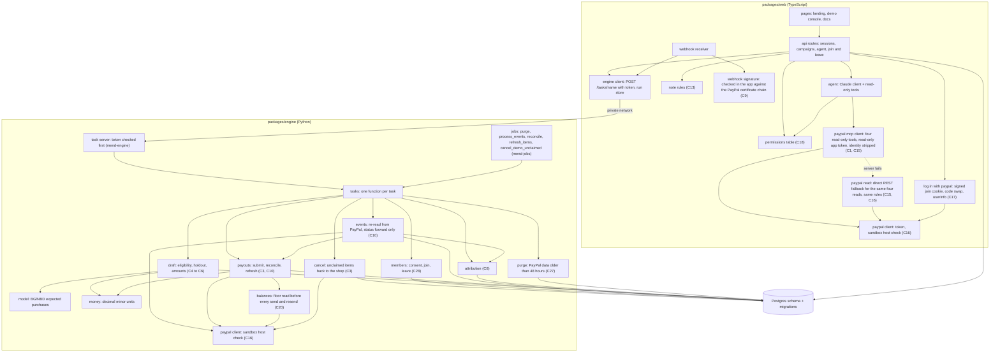

Mend finds a small shop's regular customers who have gone quiet, using the shop's own order records, and sends each a thank-you cashback into their PayPal, after the owner approves. Only customers who joined the shop's thank-you list with Log in with PayPal can be paid. A random holdout group in every campaign gets nothing, so the lift is measured.

Everything runs against the PayPal sandbox. The C numbers (C1 to C28) are the rules of the [threat model](/docs/security/threat-model).

## Parts

| Part | Where it runs | Job |
|---|---|---|
| Web app (`packages/web`) | Next.js on a Render web service (mend-web, Starter) | Landing page at `/`, the demo console at `/demo`, `/docs`; API routes for sessions, campaigns and the agent; the PayPal webhook receiver, which checks each delivery's signature itself against PayPal's certificate chain and never calls PayPal's verify API (C9). Calls the engine over Render's private network. After storing each verified webhook it asks the engine to run process_events at once, without waiting for the answer. Reads PayPal orders, disputes and products for the agent from its own server: four read-only tools on PayPal's hosted MCP server, with identity fields stripped before Claude sees anything. Those reads use a second sandbox app made without the Payouts permission. When PayPal's MCP server fails with a setup error, cannot be reached or breaks the protocol, and at least 5 of the call's 15 seconds are left, the same four reads go straight to PayPal's REST API under the same rules, and each answer says which way it came. Runs Join with PayPal (Log in with PayPal, sandbox): the confirmation page, the sign-in redirect and the callback. Talks to Claude. Never sends money itself. |
| Engine (`packages/engine`) | Python task server, a Render private service (mend-engine, Starter), reachable only on Render's private network at `http://mend-engine:10000` behind a shared token (`MEND_ENGINE_TOKEN`) | Imports the shop's own order records; scores customers with BG/NBD; builds campaign drafts (eligible set, holdout, amounts, all in code); reads the shop's PayPal balance before every send and sends nothing below the floor (C20); sends approved batches through Payouts; cancels unclaimed rewards on request; reconciles and refreshes payout status; records purchases and attribution. The only code that moves money (C1). |
| Database | Render Postgres (mend-db, basic 256 MB, Postgres 18, virginia) | Shop order records, members and consent, customer scores, campaigns and snapshots, payout items, attribution, sessions, append-only audit log (C23). |
| Scheduled jobs (`mend_engine.jobs`) | Render cron job every 5 minutes (mend-jobs, Starter) | Runs purge, process_events, reconcile, refresh_items (re-reads every unsettled payout item from PayPal after 15 minutes, so a lost webhook cannot leave the ledger stale) and cancel_demo_unclaimed (demo rewards still unclaimed after 10 minutes go back to the shop) directly in Python against the database. It never calls mend-engine and holds no engine token. process_events re-reads each stored webhook's resource from PayPal and acts only on PayPal's answer (C10); reconcile settles campaigns whose batch outcome is unknown without ever making a second batch (C3); purge runs first and deletes stored PayPal payloads at 47 hours, so none outlives 48 (C27). Locally, `npm run dev:console` runs the same command every 30 seconds. |
| Operator scripts (`scripts/deploy/render.mjs`, `mend_engine.seed_demo`, `mend_engine.prove_*`, `packages/web/scripts`) | A developer's machine | Build and check the Render setup; import the real dataset as the demo shop's order records; reproduce the published benchmark; run the backtest; the live prove-it command; the local stack (`npm run dev:console`). |
| PayPal (sandbox) | PayPal | OAuth, Payouts, Orders v2, Reporting balances, Webhooks, Log in with PayPal, the hosted MCP server, and read-only Disputes and Catalog Products calls for the REST fallback. Transaction Search is called by one proof script only. |
| Read-only PayPal app | PayPal sandbox, the same business account | A second sandbox app created without the Payouts permission. Its keys (`PAYPAL_READ_CLIENT_ID`, `PAYPAL_READ_CLIENT_SECRET`) live on mend-web only and serve only the agent's four reads. PayPal answers 403 when its token asks for a payout batch, so a leaked read token cannot pay anyone. When the pair is not set, the reads use the main app's keys. |
| Claude Haiku 5.5 | Anthropic API | Reads the owner's goal into structured campaign settings; writes one note per customer; answers the owner's questions through read-only tools. Never chooses an amount or a recipient (C4, C5, C11). |

Where each PayPal call lives:

| PayPal call | Caller | How |
|---|---|---|
| `POST /v1/oauth2/token` | web, engine, jobs | REST, token cached until `expires_in` |
| Transaction Search `GET /v1/reporting/transactions` | M1 proof script only (`mend_engine.prove_m1`) | Server SDK (Python). Used only by the M1 proof script today; no live task calls it. |
| Payouts create `POST /v1/payments/payouts` | engine (submit), jobs (reconcile resend with the same sender_batch_id, C3) | REST |
| Payouts show batch and show item | engine (process_events), jobs (refresh_items, reconcile) | REST |
| Payouts cancel unclaimed `POST /v1/payments/payouts-item/{id}/cancel` | engine (cancel_unclaimed task), jobs (cancel_demo_unclaimed) | REST, sent once and never retried in the same call |
| Reporting balances `GET /v1/reporting/balances` | engine and jobs, before every send and resend | REST; nothing is sent when the batch, its fees and the floor (`MEND_BALANCE_FLOOR_MINOR`, USD 250 by default) do not fit, and a failed read counts as too low |
| Orders v2 create with PayPal's sandbox test card, and read | engine (simulate task), jobs (refresh_items), web agent (get_order fallback) | REST; the order is captured at once with no buyer login |
| Webhooks create, list, update event types | deploy script (`render.mjs`) | REST |
| Webhook signing certificate `https://api.sandbox.paypal.com/v1/notifications/certs/CERT-<id>` | web | Downloaded only at that exact address, chained to a root Node ships, cached until it expires; the signature is checked in the app |
| Log in with PayPal (`/connect`, `/v1/oauth2/token`, userinfo `schema=paypalv1.1`, then `schema=openid` only on a 404) | web | REST; scopes openid, email, paypalattributes |
| PayPal's hosted MCP server, four read-only tools (`get_order`, `list_disputes`, `get_dispute`, `show_product_details`) | web agent, through mend-web's own server, with the read-only app's token | Mend's MCP client (`paypal-mcp.ts`) at `mcp.sandbox.paypal.com`; any other tool name is refused before a token is fetched, and each answer is rebuilt from listed fields with identity stripped before Claude sees it |
| Direct REST fallback for the same four reads (`GET /v2/checkout/orders/{id}`, `/v1/customer/disputes`, `/v1/customer/disputes/{id}`, `/v1/catalogs/products/{id}`) | web agent (`paypal-read.ts`) | Only when the MCP server fails with a setup error, cannot be reached or breaks the protocol, with at least 5 seconds left; same inputs, host check, headers, 1 MB cap and rebuilt views; each answer is marked `via paypal_mcp` or `via paypal_rest` |

## 1. System overview

## 2. Main sequence: one campaign, end to end

## 3. Module dependencies

## How the web calls the engine

Each task is one `POST /tasks/<name>` with the body `{"args": [...]}` and the `x-mend-engine-token` header, sent to `MEND_ENGINE_URL` (`http://mend-engine:10000`). The web refuses to send anything unless that address is plain `http` to a one-label host (a Render private network name: no dots, not an IP address, not localhost) with no path, query or userinfo, and the token is at least 32 printable characters. Redirects are refused, so the token cannot be carried to another host. The call runs in the background with a 120-second limit; the route answers with a run id, the run's state lives in an in-process run store (the latest 500 runs, none kept across a restart), and `GET /api/runs/<id>` polls it, answering only the session that started the run. A session has at most 2 engine calls in flight. An answer over 1 MB or of the wrong shape counts as a failed run (C12). The engine compares the token in constant time before it reads the path or body, runs at most 16 tasks at once (the five heavy reads share 6 of those slots), and answers 503 after 60 seconds without a free slot. mend-jobs does not use this path: it runs its five jobs in its own process. No service holds a Render API key.

## The local stack

`npm run dev:console` in `packages/web` runs the whole product on one machine with real data and real sandbox payouts:

- A local Postgres (pgserver, from the engine's dev and test extras), with the demo shop in its own schema, `console_dev`. The first run applies the schema and runs `mend_engine.seed_demo`, which downloads UCI Online Retail II, imports it and measures the model (131 seconds on 28 Oct). Later runs reuse it in a few seconds.
- The engine's dev bridge on `127.0.0.1` in place of mend-engine, behind a token made new for each run.
- `python -m mend_engine.jobs all` every 30 seconds in place of mend-jobs. No PayPal webhook can reach the machine, so these runs read PayPal instead; locally they re-read a new batch's items after 45 seconds rather than 15 minutes (`MEND_DEV_REFRESH_AFTER_SECONDS`, honoured only in local development, never set on Render).
- `next dev` on `127.0.0.1`, port 3001 unless `--port` says otherwise, with the console at `/demo`.

It reads the repo's `.env`, prints no setting's value, and stops everything on Ctrl+C.

## Open items

- Real return purchases are not attributed yet. The demo shop has no live storefront, so every return in the demo is a simulated sandbox purchase, labelled as simulated and kept out of the verdict. A production shop would match its own order record to the member first (`campaigns/attribution.py`).
- Rate counts live in one process's memory. Render runs one mend-web instance today; the counts would multiply if it scaled out (threat model, 26 Oct round 2).
- Transaction Search showed no rows 27 minutes after the M0 payments on 20 Oct. No live task uses it; recheck before one does.

Every route the browser calls is on the [API page](/docs/developers/api).
